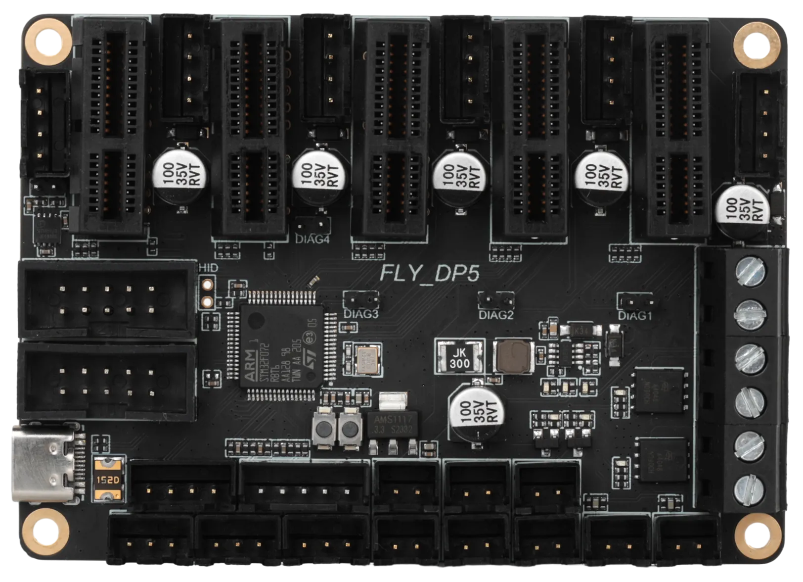
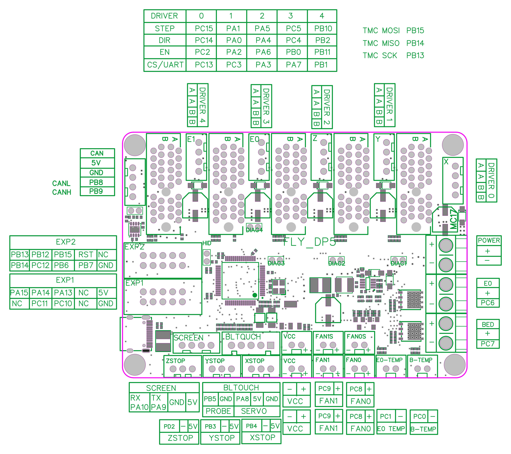
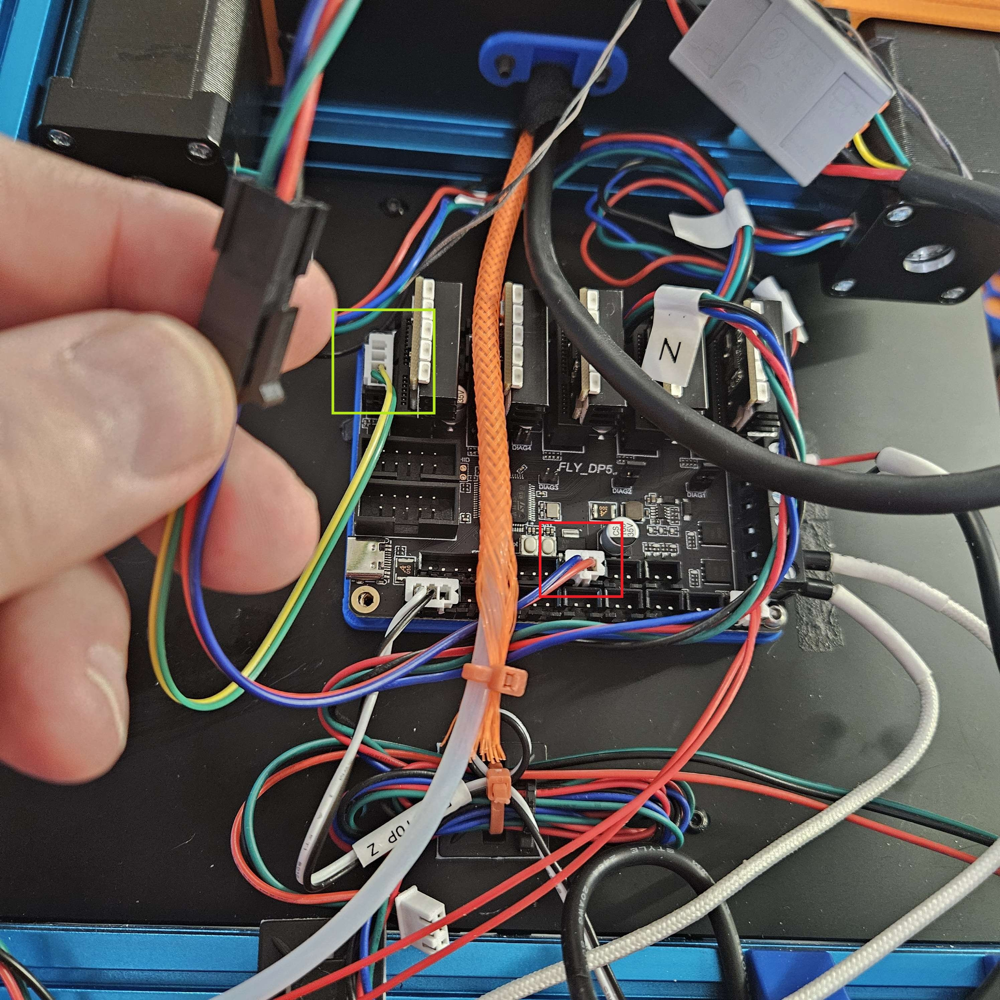
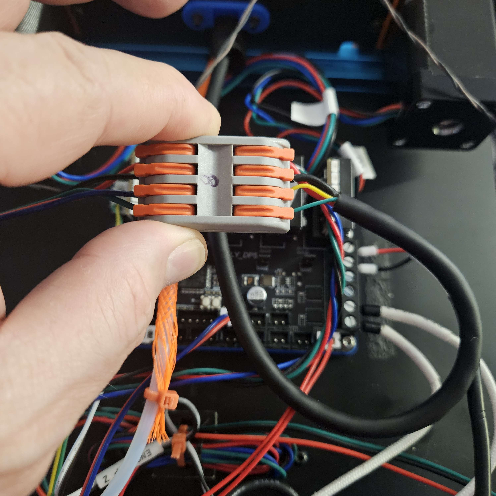

# Mellow-Fly-DP5


The board I am currently using in my v0.2 printer is a [Mellow Fly -DP5](https://www.aliexpress.us/item/3256806079050403.html).
It comes with 5 TC2209-RGB drivers that have 5 RGB LEDs on them each. It came with 5 heat sinks for the drivers as well.

The Mellow Fly DP5 is a small, 5 independent driver MCU board comparible to the SKR Pico board used frequently in the Voron V0. It is a bit larger than the Pico but comes with not only CAN on board, but also support for the normal 12864 remote display. The DP5 does not have a dedicated RGB port if you are looking for that. The built in RGB for the Drivers replaces that.  More on that setup later.





Here is a picture showing the size comparison with a Pico and a Pi and the DP5. The DP5 is only slightly bigger than the other 2. I feel that using the onboard CAN interface will make a huge difference in the amount of room available on the back of the printer. Especially since I use an external host and not a Pi. One thing to note on the DP5 is that the connectors are all top-in plugs while the Pico are side-in plugs for most things. This will help offset the added footprint for the connectors.


As for a difference in cost, the set I got from Ali Express (link above) cost me right at $30 but included the 2209 driver step sticks. The DP5 does support other driver types - Mellow also has 2240 drivers in the same form factor on their site for sale. The 2209 drivers are listed for close to $3 per stick, while the 2240s are a little more than double that. 

One feature that I like on the DP5 over the Pico is that the drivers are all separate. The pico has 2 Z motor ports on the same stepper - like most Ender style boards do. This means the DP5 can handle 5 totally independent motors where the pico cannot. Also, the drivers being sticks instead of soldered (like on the Pico) means that if you let the magic smoke out of one of the drivers, you can easily replace it.

Keep in mind, this writeup is my personal implementation of the Mellow Fly DP5 board. I guarantee you it will not be like yours, but you are free to use the information to assist you in implementing it on your printer. My setup is as follows:

    V0.2-ish printer I got used in a box in pieces
    Tulip gantry  (Hi Drifty)
    Intel Nuc host -> BTT U2C board -> EBB36 CAN setup  [Edit] I have since changed to Bridge mode - no U2C now.
    Mellow Fly DP5 controller replacing an SKR Pico that came with the parts

There is nothing wrong with the Pico, I just saw the DP5 and wanted to test it. So far I like it.


# Replacement process
## Important Information
The DP5 has 5 independent drivers, but only 4 of them support Diag pins and can be used with sensorless homing. The default config assumes that  you are using stepper drivers 0, 1, and 2 for X, Y, and Z steppers.

## Flashing the board
My instance of the DP5 came with katapult flashed on the board already. I was able to follow Esoterical's documentation for flashing the board as he has the info for the DP5 already there. It's not very different from the SKR Pico, so flashing it was extremely simple. Once I had the board flashed, I was able to start the process os systematically unplugging from the Pico and then plugging right into the DP5.

If, on the chance your board does not come pre-flashed with katapult, you can use Esoterical's CANBUS guide to flash the board. Start here and follow his instructions. It's a good guide and should get you going. [Mainboard Flashing](https://canbus.esoterical.online/mainboard_flashing.html)

The information for how to configure katapult and klipper are shown here: [Configuration for Katapult/Klipper compilation](https://canbus.esoterical.online/mainboard_flashing/common_hardware/Mellow%20Fly-D5P/README.html)

[EDIT: A few hours later...]
So I decided I wanted even less things on the back of the printer. Right now the only electronic device on the back panel of the printer is the DP5. I used Esoterical's guide to put CAN on the controller, and it just worked. I ran through Esoterical's CAN setup from the beginning just to make sure I didn't miss anything. You should also always do that. His guide is truly amazing and very accurate. But...

It's a big *but*...

The CAN interface on the DP5 doesn't expose 24v like the EBB36 I have needs. So I had some decisions to make. Here's my decision making for this change to the printer.

- I have a good, working CAN cable with jacketted ferrules on the ends that I use to connect to the screw terminals on the U2C that I previously was using on the printer. I don't want to shorten that cable any more than it is so I didn't want to lose the ferrules.
- The CAN connector on the DP5 does not expose 24V so I have to get that from somewhere else. Thankfully there are 2 ports conveneintly placed in the middle of the ports.
    
I made a pigtail. In the picture below, the pigtail is shown. The red box shows where I pulled 24V/GND, and the green box is the 4 pin CAN H/L connector. The CAN connector is is a 4 pin JST, but I only used the 2 CAN H/L pins. All 4 of those connections go to a Microfit connector that then heads to a 4 pin parallel clip connector. This connector is shown in the second picture. I was lucky that the ferrules fit into one side so I didn't have to remove them. 

  

This the connectors all in place. I fired everything up and luckily this worked on the first attempt. I was surprised. The back panel of the printer now has only the DP5. No pi, no U2C, no PSU.  Just the DP5.  


## Replacing the board
When I went to replace the Pico with the DP5 I tried to be as plug and play as possible. I left the Pico in it's place and put plugs in the ports that matched on the DP5.

Before plugging in the drivers in their slots, you will need to plug the motors in because the heat sinks that come with the TC2209-RGB are very large and the plugs can't be plugged in with the drivers in place. 

  


Also I placed the heat sinks on the back side under the LEDs because the tallest part of the driver chip side is the driver itself and the heat sink would be too wobbly in my opinion. I do not think the LEDs will get too hot, and the driver PCB has a heat plane built in so I believe this will work ok.

  

## Ports used on the DP5
These are the ports that I used for the various parts of the printer:


    B motor is plugged into stepper 0 with Diag1 jumpered
    A motor is plugged into stepper 1 with Diag2 jumpered
    Z motor is plugged into stepper 2 with Diag3 left unjumpered
    Power from PSU is plugged into the Power port
    Bed heater is plugged into the port labelled with PC7
    Bed thermistor is plugged into the BED-Temp port
    The CAN +24v/GND are plugged into the power port indicated by the callout
    The Z-Endstop switch is plugged into the appropriate port
    The BTT 12864 display that I have connected is plugged into the EXP1/EXP2 ports as expected
    [Edit] RGB LEDs and white LEDs are now plugged in - RGBs to the BLTouch and white chamber LEDs to the X-Stop port for power
    [Edit] CAN h/l are now taken from the CAN port and the 120ohm resistor is in place. This let me remove the U2C from the back of the printer.

~~I have the CAN for the extruder managed separately so I am not using CAN on the DP5.~~

[Edit] So yah, I am now using the USB-CAN-Gridge mode built into the DP5.  It works very well, and was terribly easy to get configured and working.  I think that from start of the update to finished, connected, and working on the printer it took like 20 minutes. I have editted the list above to reflect changes made since I created the writeup.

# Configuration file

The configuration file that I used started as the SKR Pico one. I had settings in place and some macros that I didn't want to recreate so I simply copied the existing working Pico config, and used it as a stepping stone for the DP5 config.

The parts that I changed are listed below.  Bear in mind that your settings and values could and probably will be different in many cases so do not just copy and paste what I have included here.

## Board pins
I included the board pins portion of the mellow config from their documentation:

```
[board_pins]
aliases:
    # Stepper drivers
    D0_EN=PC2,   D0_STEP=PC15,  D0_DIR=PC14,  D0_CS=PC13, D0_STOP=PB4,  # X
    D1_EN=PA2,   D1_STEP=PA1,   D1_DIR=PA0,   D1_CS=PC3,  D1_STOP=PB3,  # Y
    D2_EN=PA6,   D2_STEP=PA5,   D2_DIR=PA4,   D2_CS=PA3,  D2_STOP=PD2,  # Z
    D3_EN=PB0,   D3_STEP=PC5,   D3_DIR=PC4,   D3_CS=PA7,  D3_STOP=PB5,  # E0
    D4_EN=PB11,  D4_STEP=PB10,  D4_DIR=PB2,   D4_CS=PB1,                # E1

    # Heaters
    BED_OUT=PC7,
    HEAT0=PC6,

    # Thermisors
    BED_TEMP=PC0,
    HEAT0_TEMP=PC1,
   
    # Fans
    FAN0=PC8, FAN1=PC9,

    # EXP1 header
    EXP1_1=<NC>,  EXP1_3=PC11,  EXP1_5=PC10,  EXP1_7=<NC>,  EXP1_9=<GND>,
    EXP1_2=PA15,  EXP1_4=PA14,  EXP1_6=PA13,  EXP1_8=<NC>,  EXP1_10=<5V>,
    
    # EXP2 header
    EXP2_1=PB14, EXP2_3=PC12,  EXP2_5=PB6,   EXP2_7=PB7,    EXP2_9=<GND>,
    EXP2_2=PB13, EXP2_4=PB12,  EXP2_6=PB15,  EXP2_8=<RST>,  EXP2_10=<NC>,

    # BL Touch
    SERVO=PA8   # BL Touch servo pin
```

## MCU call out
This made the rest of the config easier to get correct.  I included the MCU in the config next:

```
[mcu]
serial: /dev/serial/by-id/usb-Klipper_stm32f072xb_3B0023000457434630323420-if00
restart_method: command
```

[Edit] Since adding CAN Bridge mode, I had to change this setting. I commented out the USB version of the setting, and replaced it with the CAN version shown below.

```
[mcu]
canbus_uuid: 4a679170359e
```

## Main Config changes
The next portions of the config have been trimmed to only include the parts that are necessary to make the config work. If a setting was not needed, I have included it here with a comment to indicate it was not needed.

```
[stepper_x]
step_pin: D0_STEP
dir_pin: D0_DIR
enable_pin: !D0_EN

[tmc2209 stepper_x]
uart_pin: D0_CS
#tx_pin: PA10
#uart_address: 0
diag_pin: D0_STOP

[stepper_y]
step_pin: D1_STEP
dir_pin: D1_DIR
enable_pin: !D1_EN

[tmc2209 stepper_y]
uart_pin: D1_CS
#tx_pin: PA10
#uart_address: 2
diag_pin: D1_STOP

[stepper_z]
step_pin: D2_STEP
dir_pin: !D2_DIR
enable_pin: !D2_EN
endstop_pin: D2_STOP

[tmc2209 stepper_z]
uart_pin: D2_CS
#tx_pin: PA10
#uart_address: 1

[heater_bed]
heater_pin: BED_OUT
sensor_pin: BED_TEMP

[heater_fan hotend_fan]
pin: FAN0
```

The Rest of the configuration is - in my estimation - optional. 

# Optional Configuration
## TC2209-RGB Driver LEDs

The DP5 doesn't have a dedicated RGB port. I have more information on using RGBs coming in a later update that will appear here, but there is a RGB pin you can use to enable the RGBs that are built into the TC-2209-RGB steppers that came with the board.  The config is identical to a normal RGB port. They are very bright LEDs so I have the initial value set to 0.1 and you will need to tell the printer how many drivers worth (5 on each) you want to support. The work great with the LED Effects setup that is standard for the 3 LED Stealthburner configuration. Just change the number of LEDs in the `chain_count` setting and it should be fine.

This config is used with the LED Effects part of the regular Voron configuration. I did not include that in my writeup.

```
[neopixel rgb1]
pin: PB7
chain_count: 25
color_order: GRB
initial_RED: 0.0
initial_GREEN: 0.1
initial_BLUE: 0.0
```

Having no dedicated RGB port didn't disuade me from putting RGB LEDs on the printer. I used the BLTouch connector for this. I had previously mounted 1 19-led string LEDs to the back of each of the front extrusions. As each of these LED strands has their own 3 conductor wire, I used the Data lines on the BLTouch gpio pins, GND from the BLTouch port, and then a Wago to link the +5v from each LED strand to the BLTouch +5v pin. I included a captioned screenshot of the BLTouch port.  Green is the gpio pin used for the Data line on the LEDs, and the Red and Black are the +5v/GND connections. 


The configuration for the LEDs is below:

```
[neopixel rgb2]
pin: PB5
chain_count: 19
color_order: GRB
initial_RED: 0.0
initial_GREEN: 0.1
initial_BLUE: 0.0

[neopixel rgb3]
pin: PA8
chain_count: 19
color_order: GRB
initial_RED: 0.0
initial_GREEN: 0.1
initial_BLUE: 0.0
```

I added these 2 neopixel entries to the Stealthburner config I use with LED Effects and they are effectively added to the chain of LEDs on the TC2209-RGB drivers. For me, that means 25 + 19 + 19 RGB LEDs.

## White "chamber" leds

This setup was really straightfoward. I taped a length of 3mm small white 5v LEDs to the underside of the lower top extrusions. The upper extrusions didn't have enough clearance for them and I didn't want to print anything to angle them off the top extrusion. This works for me :-)  

At any rate, I just used the X-stop plug for powering them.  The endstop ports on the DP5 all have a data pin, GND, and 5V so it was an easy choice to use one of them. I made a 3 pin JST connector that only has the pins on the 5v and GND pins. This way the white LEDs are on with then DP5 has power. Of course that means they are only off if I unplug the DP5. You can see the X-Stop port in the picture above below the BLTouch connector.


## BTT Mini 12864 display
The Mini-12864 display is one that I had on hand and wanted to see if it would work. It does.

As I am old it's a better display for me than the tiny OLED display that normally comes with a v0. I commented out the beeper pin because for some reason it was not happy due to the EXP definitions and I didn't want ot active anyway.


```
[display]
lcd_type: uc1701
cs_pin: EXP1_3
a0_pin: EXP1_4
rst_pin: EXP1_5
encoder_pins: ^EXP2_5, ^EXP2_3
click_pin: ^!EXP1_2
## Some micro-controller boards may require an spi bus to be specified:
#spi_bus: spi
## Alternatively, some micro-controller boards may work with software spi:
contrast: 63
spi_software_miso_pin: EXP2_1
spi_software_mosi_pin: EXP2_6
spi_software_sclk_pin: EXP2_2

# [pwm_cycle_time beeper]
# pin: EXP1_1

[neopixel btt_mini12864]
#   To control Neopixel RGB in mini12864 display
pin: EXP1_6
chain_count: 3
initial_RED: 0.1
initial_GREEN: 0.1
initial_BLUE: 0.0
color_order: RGB

#   Set RGB values on boot up for each Neopixel.
#   Index 3 = display, Index 1 and 2 = Knob
[delayed_gcode setdisplayneopixel]
initial_duration: 1
gcode:
    SET_LED LED=btt_mini12864 RED=1 GREEN=0 BLUE=0 INDEX=1 TRANSMIT=0
    SET_LED LED=btt_mini12864 RED=1 GREEN=0 BLUE=0 INDEX=2 TRANSMIT=0
    SET_LED LED=btt_mini12864 RED=1 GREEN=1 BLUE=1 INDEX=3
```

# Links

- Mellow's documentation for the DP5 [github](https://mellow-3d.github.io/fly_DP5.html)
- Mellow Product documentation for the DP5 [docs](https://mellow.klipper.cn/docs/ProductDoc/MainBoard/fly-d/fly-dp5/)
    This is partially in Chinese and Chrome didn't want to translate some of it :-)

# Thanks
- Xiar for the information I couldn't locate.
- ZeroTacos for telling me I should write this up.