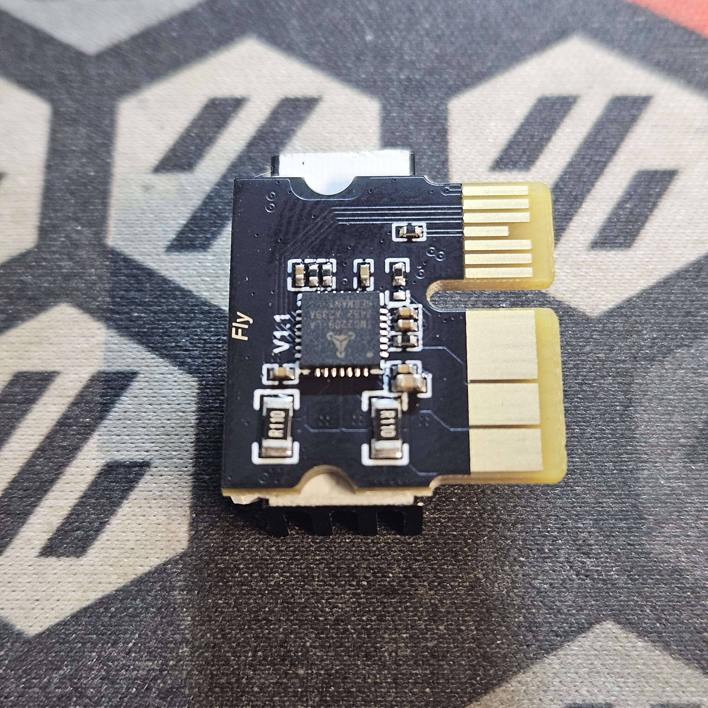
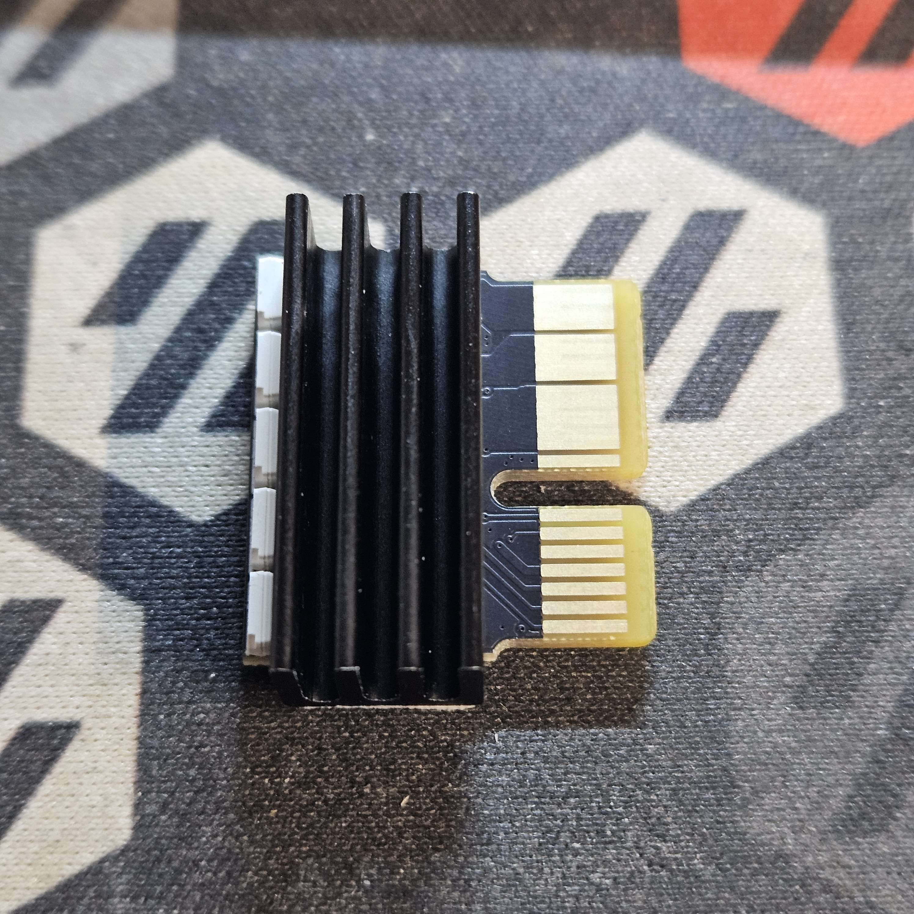

# Mellow-Fly-DP5
This writeup is my personal implementation of the Mellow Fly DP5 board. I guarantee you it will not be like yours, but you are free to use the information to assist you in implementing it on your printer. My setup is as follows:

    V0.2-ish printer I got used
    Tulip gantry
    Intel Nuc host -> BTT U2C board -> EBB36 CAN setup
    Mellow Fly DP5 controller replacing an SKR Pico that came with the parts

There is nothing wrong with the Pico, I just saw the DP5 and wanted to test it.

The Mellow Fly DP5 is a small, 5 independent driver MCU board comparible to the SKR Pico board used frequently in the Voron V0. It is a bit larger than the Pico but comes with not only CAN on board, but also support for the normal 12874 remote display. The DP5 does not have a dedicated RGB port if you are looking for that. The built in RGB for the Drivers replaces that.  More on that setup later.

# Replacement process
## Important Information
The DP5 has 5 independent drivers, but only 4 of them support Diag pins and can be used with sensorless homing. The default config assumes that  you are using stepper drivers 0, 1, and 2 for X, Y, and Z steppers.

## Flashing the board
My copy of the DP5 came with katapult flashed on the board already. I was able to follow Esoterical's documentation for flashing the board as he has the info for the DP5 already there. It's not very different from the SKR Pico, so flashing it was extremely simple. Once I had the board flashed, I was able to start the process os systematically unplugging from the Pico and then plugging right into the DP5.

## Replacing the board
When I went to replace the Pico with the DP5 I tried to be as plug and play as possible. I left the Pico in it's place and put plugs in the ports that matched on the DP5.

Before plugging in the drivers in their slots, you will need to plug the motors in because the heat sinks that come with the TC2209-RGB are very large and the plugs can't be plugged in with the drivers in place. 

  


>

Also I placed the heat sinks on the back side under the LEDs because the tallest part of the driver chip side is the driver itself and the heat sink would be too wobbly in my opinion. I do not think the LEDs will get too hot, and the driver PCB has a heat plane built in so I believe this will work ok.

  

    B motor is plugged into stepper 0 with Diag1 jumpered
    A motor is plugged into stepper 1 with Diag2 jumpered
    Z motor is plugged into stepper 2 with Diag3 left unjumpered
    Power from PSU is plugged into the Power port
    Bed heater is plugged into the port labelled with PC7
    Bed thermistor is plugged into the BED-Temp port
    The CAN +24v/GND are plugged into the power port indicated by the callout
    The Z-Endstop switch is plugged into the appropriate port
    The BTT 12864 display that I have connected is plugged into the EXP1/EXP2 ports as expected

I have the CAN for the extruder managed separately so I am not using CAN on the DP5.

# Configuration file

The configuration file that I used started as the SKR Pico one. I had settings in place and some macros that I didn't want to recreate so I simply copied the existing working Pico config, and used it as a stepping stone for the DP5 config.

The parts that I changed are listed below.  Bear in mind that your settings and values could and probably will be different in many cases so do not just copy and paste what I have included here.

## Board pins
I included the board pins portion of the mellow config from their documentation:

```[board_pins]
aliases:
    # Stepper drivers
    D0_EN=PC2,   D0_STEP=PC15,  D0_DIR=PC14,  D0_CS=PC13, D0_STOP=PB4,  # X
    D1_EN=PA2,   D1_STEP=PA1,   D1_DIR=PA0,   D1_CS=PC3,  D1_STOP=PB3,  # Y
    D2_EN=PA6,   D2_STEP=PA5,   D2_DIR=PA4,   D2_CS=PA3,  D2_STOP=PD2,  # Z
    D3_EN=PB0,   D3_STEP=PC5,   D3_DIR=PC4,   D3_CS=PA7,  D3_STOP=PB5,  # E0
    D4_EN=PB11,  D4_STEP=PB10,  D4_DIR=PB2,   D4_CS=PB1,                # E1

    # Heaters
    BED_OUT=PC7,
    HEAT0=PC6,

    # Thermisors
    BED_TEMP=PC0,
    HEAT0_TEMP=PC1,
   
    # Fans
    FAN0=PC8, FAN1=PC9,

    # EXP1 header
    EXP1_1=<NC>,  EXP1_3=PC11,  EXP1_5=PC10,  EXP1_7=<NC>,  EXP1_9=<GND>,
    EXP1_2=PA15,  EXP1_4=PA14,  EXP1_6=PA13,  EXP1_8=<NC>,  EXP1_10=<5V>,
    
    # EXP2 header
    EXP2_1=PB14, EXP2_3=PC12,  EXP2_5=PB6,   EXP2_7=PB7,    EXP2_9=<GND>,
    EXP2_2=PB13, EXP2_4=PB12,  EXP2_6=PB15,  EXP2_8=<RST>,  EXP2_10=<NC>,

    # BL Touch
    SERVO=PA8   # BL Touch servo pin
```

## MCU call out
This made the rest of the config easier to get correct.  I included the MCU in the config next:

```[mcu]
serial: /dev/serial/by-id/usb-Klipper_stm32f072xb_3B0023000457434630323420-if00
restart_method: command
```

## Main Config changes
The next portions of the config have been trimmed to only include the parts that are necessary to make the config work. If a setting was not needed, I have included it here with a comment to indicate it was not needed.

```[stepper_x]
step_pin: D0_STEP
dir_pin: D0_DIR
enable_pin: !D0_EN

[tmc2209 stepper_x]
uart_pin: D0_CS
#tx_pin: PA10
#uart_address: 0
diag_pin: D0_STOP

[stepper_y]
step_pin: D1_STEP
dir_pin: D1_DIR
enable_pin: !D1_EN

[tmc2209 stepper_y]
uart_pin: D1_CS
#tx_pin: PA10
#uart_address: 2
diag_pin: D1_STOP

[stepper_z]
step_pin: D2_STEP
dir_pin: !D2_DIR
enable_pin: !D2_EN
endstop_pin: D2_STOP

[tmc2209 stepper_z]
uart_pin: D2_CS
#tx_pin: PA10
#uart_address: 1

[heater_bed]
heater_pin: BED_OUT
sensor_pin: BED_TEMP

[heater_fan hotend_fan]
pin: FAN0
```

The Rest of the configuration is - in my estimation - optional. 

# Optional Configuration
## TC2209-RGB Driver LEDs

The DP5 doesn't have a dedicated RGB port. I have more information on using RGBs coming in a later update that will appear here, but there is a RGB pin you can use to enable the RGBs that are built into the TC-2209-RGB steppers that came with the board.  The config is identical to a normal RGB port. They are very bright LEDs so I have the initial value set to 0.1 and you will need to tell the printer how many drivers worth (5 on each) you want to support. 

This config is used with the LED Effects part of the regular Voron configuration. I did not include that in my writeup.

```[neopixel rgb1]
pin: PB7
chain_count: 25
color_order: GRB
initial_RED: 0.0
initial_GREEN: 0.1
initial_BLUE: 0.0
```

## BTT Mini 12864 display
The Mini-12864 display is one that I had on hand and wanted to see if it would work. It does.

As I am old it's a better display for me than the tiny OLED display that normally comes with a v0. I commented out the beeper pin because for some reason it was not happy due to the EXP definitions and I didn't want ot active anyway.


```[display]
lcd_type: uc1701
cs_pin: EXP1_3
a0_pin: EXP1_4
rst_pin: EXP1_5
encoder_pins: ^EXP2_5, ^EXP2_3
click_pin: ^!EXP1_2
## Some micro-controller boards may require an spi bus to be specified:
#spi_bus: spi
## Alternatively, some micro-controller boards may work with software spi:
contrast: 63
spi_software_miso_pin: EXP2_1
spi_software_mosi_pin: EXP2_6
spi_software_sclk_pin: EXP2_2

# [pwm_cycle_time beeper]
# pin: EXP1_1

[neopixel btt_mini12864]
#   To control Neopixel RGB in mini12864 display
pin: EXP1_6
chain_count: 3
initial_RED: 0.1
initial_GREEN: 0.1
initial_BLUE: 0.0
color_order: RGB

#   Set RGB values on boot up for each Neopixel.
#   Index 3 = display, Index 1 and 2 = Knob
[delayed_gcode setdisplayneopixel]
initial_duration: 1
gcode:
    SET_LED LED=btt_mini12864 RED=1 GREEN=0 BLUE=0 INDEX=1 TRANSMIT=0
    SET_LED LED=btt_mini12864 RED=1 GREEN=0 BLUE=0 INDEX=2 TRANSMIT=0
    SET_LED LED=btt_mini12864 RED=1 GREEN=1 BLUE=1 INDEX=3
```

# Links

- Mellow's documentation for the DP5 [github](https://mellow-3d.github.io/fly_DP5.html)
- Mellow Product documentation for the DP5 [docs](https://mellow.klipper.cn/docs/ProductDoc/MainBoard/fly-d/fly-dp5/)
    This is partially in Chinese and Chrome didn't want to translate some of it :-)

# Thanks
- Xiar for the information I couldn't locate.
- ZeroTacos for telling me I should write this up.